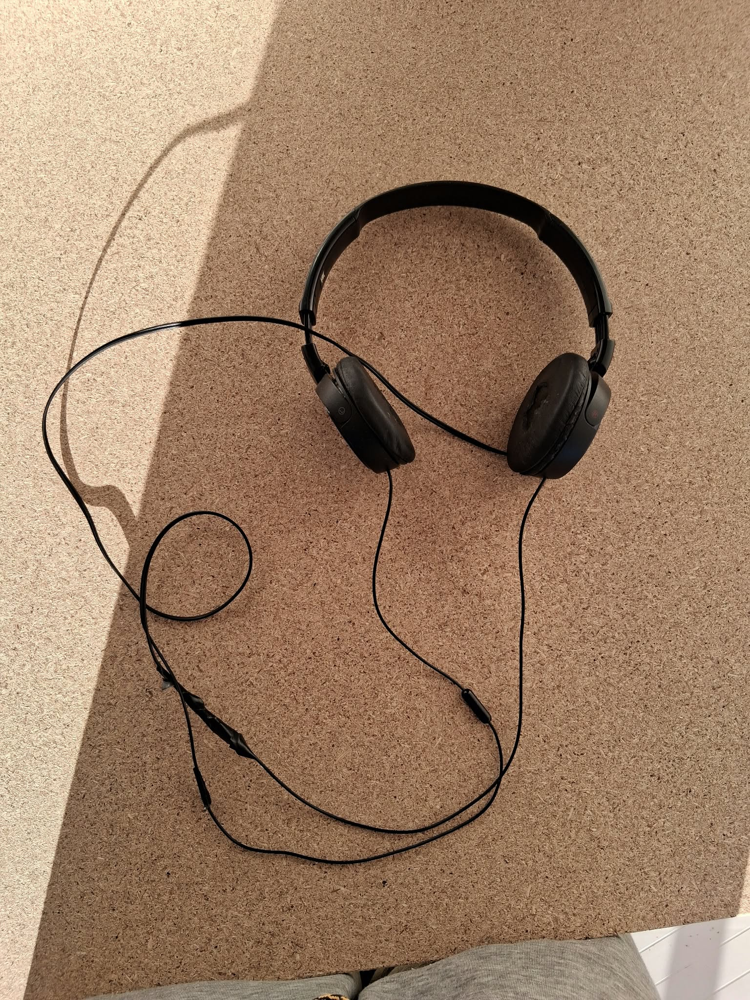
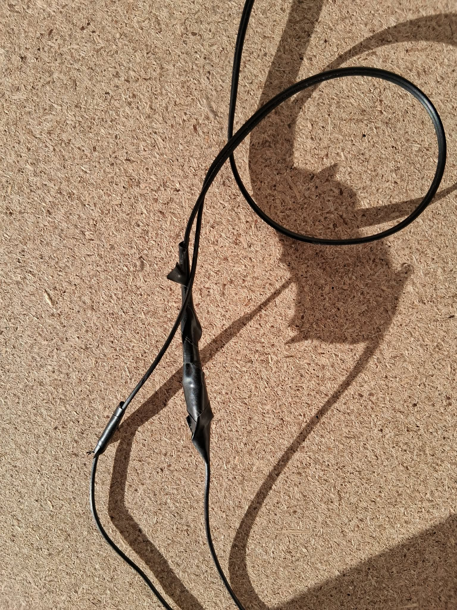
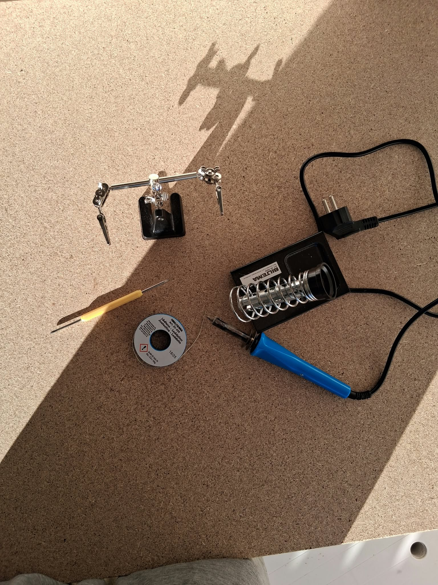

# 🛠️ Sony Headphone Cable Repair (Litz Wire & Soldering Techniques)

This project documents the practical troubleshooting and successful repair of a pair of Sony headphones where the cable to one of the ear cups had snapped. The project serves as a practical self-study in handling ultra-fine enameled conductors and maintaining thermal control under challenging laboratory conditions.

## 🔧 Tools Used in the Lab
* **Soldering Iron:** Biltema (standard unregulated soldering iron) with spring stand
* **Fixing & Positioning:** "Helping Hand" with alligator clips and a fine mechanical probe
* **Consumables:** Standard soldering tin and electrical insulation tape

## 💡 Inspiration and Lessons Learned
* **Inspiration:** This repair was inspired by mechanics channels on YouTube, specifically `@LyThiXien-886` (formerly Ly Ly Mechanical), which demonstrate advanced troubleshooting and mechanical repairs of damaged wiring harnesses using basic tools.
* **Lab Experience:** Because the wire leads were extremely short and the circuit lacked external strain relief during the joining process, keeping everything stable was a significant challenge. This resulted in a few classic finger burns along the way, but provided valuable experience regarding the importance of proper fixation and patience in fine mechanical work.

## 🔍 Troubleshooting Methodology & Technical Challenges
1. **Verifying the Fault Location:** Troubleshooting was initially attempted with a digital multimeter, but due to the thin insulation lacquer on the conductors, it did not provide a reliable reading. The break location and signal path were subsequently identified by performing a mechanical compression test (squeezing the leads together) during continuous audio playback until stable, uninterrupted two-way audio was verified.
2. **Oxidation and Enamel Removal:** The red signal conductor was coated with a colored enamel lacquer that prevented the solder from adhering (poor wetting). Using a basic soldering iron increased the risk of rapid oxidation on the tip, causing the tin to bead up and roll off.
3. **Thermo-Mechanical Soldering Technique:** To overcome this, the soldering iron was placed underneath the joint for maximum heat transfer (burning off the enamel lacquer), while the fine mechanical tool was used from above to pinch the conductors stably together at the exact moment of melting. This overcame the oxidation, stripped the remaining lacquer, and ensured immediate adhesion.
4. **Insulation:** The joint was immediately insulated with tape after a successful function test to act as a temporary strain relief and prevent short circuits during future use.

## 📸 Images from the Process

### Product Overview

### Detail of the Soldered and Taped Cable Joint

### Tools and Equipment Used on the Workbench

